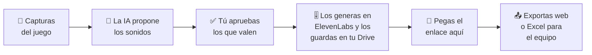

# 🎧 Game Music Studio

**Del juego a la lista de sonidos con sus prompts, y de ahí al documento que recibe el equipo.**

[Pruébala](#-pruébala-en-15-minutos) · [Preguntas frecuentes](#-preguntas-frecuentes) · [Guía paso a paso](docs/guia-puesta-en-marcha.md) · [Para quien desarrolla](docs/para-desarrolladores.md)

---

Subes capturas de un videojuego y cuentas cómo quieres que suene. Una inteligencia artificial propone **qué sonidos hacen falta**, cada uno con su **prompt** (la instrucción que se le da al generador de audio) ya escrito. Tú eliges cuáles producir, los generas, y la herramienta lleva la cuenta de **dónde guardaste** cada uno para entregar al final una página web o una hoja de Excel al equipo del juego.

Está pensada para que la use **cualquier persona, sin experiencia en audio**: te explica cada paso y cada palabra mientras trabajas.

## ✨ Qué te da

| | |
| :-- | :-- |
| 🧭 **Te guía** | Cuatro pasos en pantalla, con el actual resaltado y un glosario a mano. |
| 📝 **Prompts listos** | Cada sonido llega con su prompt en inglés, listo para copiar y pegar en ElevenLabs. |
| 🔒 **Tuyo y privado** | Tus claves y tus juegos viven en tu navegador. No hay cuentas ni servidores de por medio. |
| 📦 **Entrega limpia** | Exportas una página web o una hoja de Excel con los nombres y los enlaces. |

---

## 🚀 Pruébala en 15 minutos

### Lo que necesitas

1. **Node.js** (gratis): descarga la versión «LTS» en [nodejs.org](https://nodejs.org) e instálala con «Siguiente» hasta el final. Se hace una sola vez.
2. **La clave de una IA** de las que ya uses: Claude, Gemini u OpenAI. Es lo que le permite a la herramienta analizar tu juego.
3. **Una cuenta de [ElevenLabs](https://elevenlabs.io/)** para convertir los prompts en sonidos. Eso lo haces tú en su página; la herramienta no te pide su clave.

> 💡 Cada análisis gasta saldo de **tu** cuenta de IA y cada sonido, créditos de **tu** cuenta de ElevenLabs. La herramienta es gratis.

### Los tres pasos para arrancar

| | Paso | Qué haces |
| :-: | :-- | :-- |
| **1** | 📥 **Descárgala** | Pulsa el botón verde **Code → Download ZIP** en esta página, descomprime la carpeta y déjala donde no se borre sola (por ejemplo, en *Documentos*). |
| **2** | ▶️ **Ponla en marcha** | Doble clic en **`iniciar.command`** (Mac) o en **`iniciar.bat`** (Windows). Se abre una ventana con texto, que debes dejar abierta, y después tu navegador en `http://localhost:5173`. La primera vez tarda un poco más. |
| **3** | 🔑 **Conecta tu IA** | Pulsa el engranaje **⚙️** arriba a la derecha, elige tu proveedor en **Motor de IA**, pega tu clave y pulsa **Comprobar conexión**. Debe decir «Conexión correcta». |

> 🍎 En Mac, si dice que no puede abrir el archivo: clic derecho sobre él → **Abrir**. La [guía paso a paso](docs/guia-puesta-en-marcha.md) lo explica paso a paso y también cubre Windows.

### Y ahora, a crear sonidos

La pantalla te guía en cuatro pasos:

| | Paso | Qué haces |
| :-: | :-- | :-- |
| **1** | 🎮 **Cuenta tu juego** | Creas el juego, subes capturas y escribes cómo quieres que suene. Pulsas **Analizar y proponer sonidos**. |
| **2** | 📋 **Revisa la lista** | Lees lo que propone la IA, corriges lo que quieras y pulsas **Aprobar para producción** en los que vas a hacer. |
| **3** | 🎚️ **Crea y guarda** | Pulsas **Copiar prompt**, generas el sonido en ElevenLabs, lo guardas en tu Drive y **pegas su enlace** en la fila. |
| **4** | 📤 **Comparte** | Marcas **Incluir en el documento** y exportas la **página web** o la **hoja de Excel**. Se la envías al equipo del juego. |

> 👀 **¿Prefieres ver cómo queda antes de empezar?** En la pantalla inicial pulsa **Cargar el ejemplo**: es un juego inventado con su análisis y su lista de sonidos ya hechos. Sirve para leer y aprender, y no toca tus juegos.

¿Una palabra que no conoces (prompt, loop, boceto…)? Pulsa **📖 Glosario**.

---

## ❓ Preguntas frecuentes

<strong>¿Mis claves y mis juegos salen de mi ordenador?</strong>

No. Tus claves viven solo en tu navegador y únicamente se envían al proveedor de IA que elijas. Tus juegos también se guardan en tu navegador. La herramienta no envía nada a ningún servidor propio. La sincronización en la nube existe, pero es **opcional y viene apagada**: solo la activa quien despliega su propia copia (ver [Para quien desarrolla](docs/para-desarrolladores.md)).

<strong>¿Por qué los sonidos se generan a mano en ElevenLabs?</strong>

La herramienta se encarga de que el prompt salga bien escrito y de llevar la cuenta de dónde quedó cada sonido. El sonido lo generas tú y lo guardas donde ya guardas todo, por ejemplo en Drive. La herramienta nunca sube los audios: solo anota **dónde están**.

<strong>¿Cómo recibo las mejoras?</strong>

Los prompts se mantienen al día solos: la primera vez te pregunta si quieres que la herramienta consulte este repositorio al abrirse. Solo lee, no envía nada tuyo, y lo puedes apagar en ⚙️ → *Prompts del estudio*. Si algún día pide una versión nueva de la herramienta, descarga el ZIP otra vez.

<strong>¿Y sin internet?</strong>

Todo funciona salvo el análisis con la IA. Los prompts usan la última versión que descargó o la que viene incluida.

<strong>¿Hay una vista con más cosas?</strong>

Sí. Arriba está el interruptor **Simple / Completa**. La completa trae la tabla maestra, el tablero y los seis estados de cada sonido; está pensada para quien dirige el audio.

<strong>¿Algo no funciona o tienes una idea?</strong>

[Abre una incidencia](https://github.com/shgax/game-music-studio/issues/new) en este repositorio, o díselo a quien te pasó el enlace. La [guía paso a paso](docs/guia-puesta-en-marcha.md) tiene una sección «Si algo no funciona».

---

## 🛠️ ¿Desarrollas?

Los comandos, la arquitectura, cómo activar la nube y cómo desplegar están en **[docs/para-desarrolladores.md](docs/para-desarrolladores.md)**. Quien solo quiere usar la herramienta no lo necesita.

## 📄 Licencia

[MIT](LICENSE) © 2026 Francisco Alejandro Garcia Zevallos. Puedes usar, copiar y modificar la herramienta conservando el aviso de la licencia.
